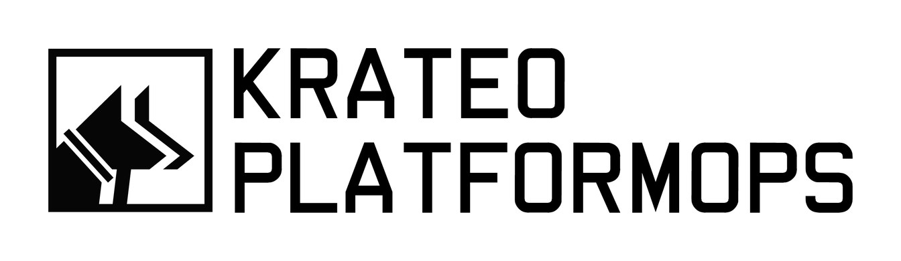

  

  An open-source control plane on Kubernetes that creates and governs any resource, on any infrastructure. 
  It validates every change, applies what was approved and keeps it true over time.

  <a href="https://github.com/krateo-platformops/krateo">Start here</a> ·
  <a href="https://github.com/krateo-platformops/installer">Install</a> ·
  <a href="https://docs.krateo.io/?utm_source=github&utm_medium=org-profile&utm_campaign=krateo&utm_content=docs-nav">Documentation</a> ·
  <a href="https://github.com/krateo-blueprints">Blueprints</a> ·
  <a href="#agentiko">AGENTIKO</a>

Platform teams publish golden paths once, as **blueprints**. Developers order what they need from a **self-service portal**, and Krateo creates it inside or outside the cluster it runs on, on the major clouds and on-premises. Everything is open source under the Apache License 2.0.

## Start here

| Repository | What it is |
|---|---|
| [krateo](https://github.com/krateo-platformops/krateo) | The front door: what Krateo PlatformOps is, how to install it, release notes |
| [installer](https://github.com/krateo-platformops/installer) | The one Helm chart that installs the whole platform, in order and readiness-gated |

## The platform

| Area | Repositories |
|---|---|
| **Composition engine** | [core-provider](https://github.com/krateo-platformops/core-provider) turns blueprints into CRDs and reconciles them · [oasgen-provider](https://github.com/krateo-platformops/oasgen-provider) generates an operator from any OpenAPI spec · [git-provider](https://github.com/krateo-platformops/git-provider) runs Git operations from the cluster |
| **Composable portal** | [frontend](https://github.com/krateo-platformops/frontend) · [snowplow](https://github.com/krateo-platformops/snowplow), the content API behind it · [portal](https://github.com/krateo-platformops/portal), the portal content as a blueprint · [authn](https://github.com/krateo-platformops/authn) · [helm-render-service](https://github.com/krateo-platformops/helm-render-service) for chart previews |
| **Observability and operations** | [observability](https://github.com/krateo-platformops/observability) (ClickHouse, OpenTelemetry, HyperDX) · [otel-collector](https://github.com/krateo-platformops/otel-collector) · [sse-proxy](https://github.com/krateo-platformops/sse-proxy) · [alert-provider](https://github.com/krateo-platformops/alert-provider) · [incident-provider](https://github.com/krateo-platformops/incident-provider) · [audit](https://github.com/krateo-platformops/audit) · [nightly-review](https://github.com/krateo-platformops/nightly-review), which proposes changes as pull requests |
| **Libraries** | [plumbing](https://github.com/krateo-platformops/plumbing) · [provider-runtime](https://github.com/krateo-platformops/provider-runtime) · [unstructured-runtime](https://github.com/krateo-platformops/unstructured-runtime) · [crdgen](https://github.com/krateo-platformops/crdgen) · forks of [gojq](https://github.com/krateo-platformops/gojq) and [libopenapi](https://github.com/krateo-platformops/libopenapi) |

Ready-to-use blueprints for AWS, Azure, Google Cloud, OpenStack, Keycloak and more live in the [krateo-blueprints](https://github.com/krateo-blueprints) organization.

## Try it

Install on your own cluster with the [installer](https://github.com/krateo-platformops/installer), or try Krateo in the browser in the [free self-service lab](https://killercoda.com/krateoplatformops).

## Community and contributing

- Questions and ideas: [GitHub Discussions](https://github.com/krateo-platformops/krateo/discussions)
- How to contribute: [CONTRIBUTING](https://github.com/krateo-platformops/.github/blob/main/CONTRIBUTING.md)
- Report a vulnerability privately: [security policy](https://github.com/krateo-platformops/.github/blob/main/SECURITY.md)

If Krateo PlatformOps is useful to you, [star the main repository](https://github.com/krateo-platformops/krateo): it helps other platform teams find it.

## AGENTIKO: agents on top of Krateo PlatformOps

AGENTIKO is the reasoning plane built by Krateo on Krateo PlatformOps. Its agents read the platform, investigate and prepare the change; Krateo PlatformOps validates it, a person approves it, and only then is it applied. AGENTIKO is a commercial product, in alpha at Kiratech since 3 August 2026.

[Learn about AGENTIKO at agentiko.eu](https://agentiko.eu/?utm_source=github&utm_medium=org-profile&utm_campaign=krateo&utm_content=agentiko-cta)

Krateo PlatformOps and AGENTIKO are developed by Krateo S.r.l., Verona, Italy.
